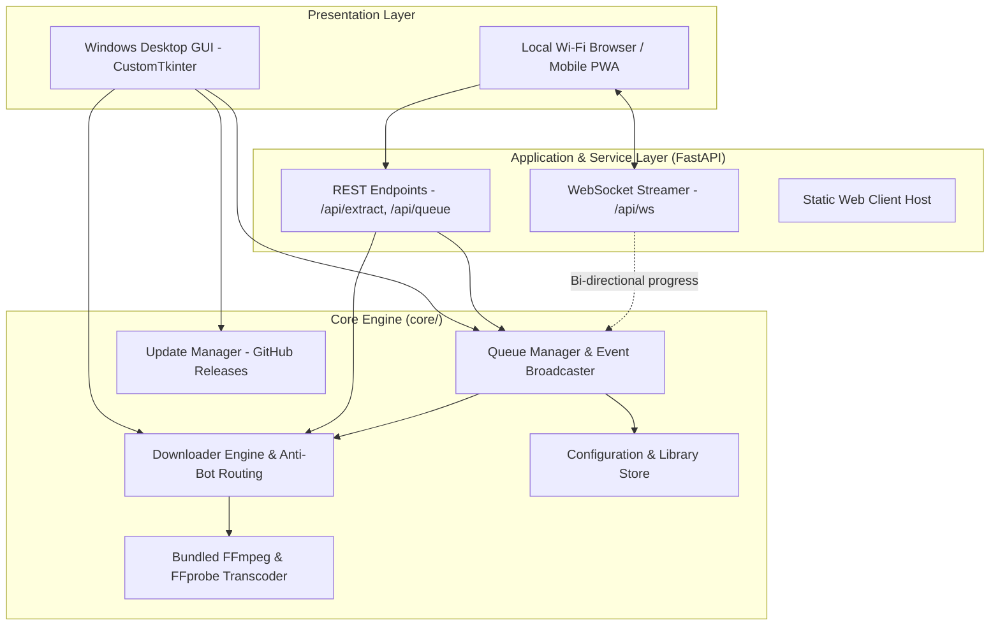

<div align="center">


# Argus Studio

**A High-Performance Desktop & Local-Network Media Ingestion and Transcoding Suite**

[](https://github.com/ChimbuezeDavidbackup/argus-studio)
[](https://github.com/ChimbuezeDavidbackup/argus-studio/releases)
[](https://www.python.org/)
[](https://github.com/TomSchimansky/CustomTkinter)
[](https://fastapi.tiangolo.com)
[](https://github.com/yt-dlp/yt-dlp)
[](LICENSE)

[Overview](#overview) • [Why Desktop-First?](#why-desktop-first) • [Engineering Challenges & Solutions](#engineering-challenges--solutions) • [System Architecture](#system-architecture) • [Key Capabilities](#key-capabilities) • [Installation & Usage](#installation--usage) • [Automated Updates & Releases](#automated-updates--release-guide) • [Build Guide](#building-from-source)

</div>

---

## Overview

**Argus Studio** is an extensible media ingestion, transcoding, and queue management suite. Engineered with a decoupled three-tier architecture, Argus Studio delivers:
1. **A Native Windows Desktop Application**: Clean, modern CustomTkinter client with live telemetry, background workers, and zero-configuration bundled media tools.
2. **An Embedded Local Web & Mobile Service**: FastAPI REST and WebSocket server for accessing the queue and downloads from phones or tablets on the same local Wi-Fi.
3. **An In-App Automated Updater**: Seamless background release discovery, streaming download, and silent in-place installation powered by GitHub Releases.

---

## Why Desktop-First?

While earlier revisions explored hosting the backend on public cloud platforms (e.g., Render, AWS, VPS), production testing confirmed that **desktop-first local execution** is fundamentally superior for media extraction:

- **Datacenter IP Blacklisting**: Major streaming platforms (such as YouTube) flag and block requests originating from cloud datacenters (AWS, DigitalOcean, Hetzner, Render), presenting persistent bot verification walls ("*Sign in to confirm you're not a bot*"). Running natively on the user's desktop leverages residential IP routing, bypassing datacenter blocks naturally.
- **Zero Cloud Bandwidth & Hosting Costs**: Transcoding and downloading multi-gigabyte 4K streams in the cloud rapidly exhausts bandwidth limits and requires expensive rotating residential proxies. A local desktop app incurs zero recurring hosting fees.
- **Direct High-Performance I/O**: Stream multiplexing (combining separate 4K video and audio DASH channels) is disk- and CPU-intensive. Local execution has direct access to the user's multi-core CPU and high-speed NVMe/SSD storage without container CPU throttling.
- **Single-Hop File Delivery**: Downloads save directly to `%USERPROFILE%\Downloads\ArgusStudio` rather than requiring a two-hop roundtrip (Host to Cloud Server, then Cloud Server to User).

---

## Engineering Challenges & Solutions

Extracting streaming media on modern systems introduces significant technical barriers, ranging from bot-detection heuristics and TLS fingerprinting to single-file packaging quirks and Windows file locks. Argus Studio addresses each through deliberate architectural mitigations:

| Technical Challenge | Root Cause / Impact | Argus Studio Engineering Solution |
| :--- | :--- | :--- |
| **Cloud Datacenter Bot Walls** | YouTube and streaming CDNs systematically block datacenter IP ranges with automated bot challenge pages. | **Desktop-First Execution**: Shifted primary ingestion to client residential IP addresses with multi-client rotation (`['android', 'ios', 'web_creator', 'mweb']`). |
| **TLS Fingerprint Blocking on Non-YouTube Sites** | Platforms like Dailymotion and Vimeo reject standard Python `urllib` / `requests` handshakes based on TLS/JA3 fingerprinting. | **`curl_cffi` Browser Impersonation**: Integrated Chrome-mimicking TLS client signatures to negotiate requests seamlessly across all supported extractors. |
| **FFmpeg Discovery in PyInstaller One-File Builds** | In PyInstaller single-file executables, `sys._MEIPASS` points to a temporary folder, missing the FFmpeg binaries installed by Inno Setup into `{app}\bin`. | **Application-Relative Discovery**: Patched `get_ffmpeg_location()` in `core/engine.py` to inspect `os.path.join(os.path.dirname(sys.executable), "bin")` first, ensuring zero-configuration operation on clean systems. |
| **GitHub Releases 404 Update Check Failures** | When querying a GitHub repository before any releases are published, GitHub returns an HTTP 404, which previously surfaced as an unhandled connection error. | **Safe Fallback Handling**: Updated `core/updater.py` to treat HTTP 404 as `"Running latest build"` rather than a network error, preventing misleading failure prompts. |
| **DASH Stream Multiplexing** | High-definition streams (1080p, 1440p, 4K) serve separate video and audio channels requiring multiplexing. | **Bundled Portable FFmpeg Engine**: Full static `ffmpeg.exe` and `ffprobe.exe` binaries packaged directly into the Inno Setup installer package. |
| **Windows File Locking (`WinError 32`)** | Antivirus scanners and Windows Search Indexers lock `.part` files during download finalization. | **Direct-to-Target File I/O**: Stream writes directly to destination container (`nopart: True`) with exponential retry backoff (`file_access_retries: 10`). |
| **Browser Cookie Locking** | Active web browsers hold exclusive locks on SQLite session databases. | **Non-Blocking SQLite Isolation**: Automatically releases locks and falls back to unauthenticated public endpoints without stalling the queue. |
| **Win32 OLE Cross-Thread Collisions** | Accessing the clipboard from worker threads causes Tcl/Tk native access violations on Windows. | **Thread-Safe Mainloop Polling**: Isolates all clipboard detection to Tkinter’s native event-loop scheduler (`after()`). |
| **Silent Failures in Windowed PE Builds** | Packaged GUI executables (`--noconsole`) swallow `stdout`/`stderr`, hiding errors from users. | **Diagnostic Instrumentation**: Top-level exception trapping (`sys.excepthook`) and stream redirection log full tracebacks to `%APPDATA%\ArgusStudio\argus_runtime.log`. |

---

## System Architecture



---

## Key Capabilities

### Video Ingestion & Stream Multiplexing
- Supports single video, channel, and playlist extraction across multiple providers (YouTube, Dailymotion, Vimeo, etc.).
- Resolution selection up to 4K (2160p), 1440p, 1080p, and adaptive best-quality profiles.
- Automatic multiplexing into standardized MP4 and MKV containers.

### Audio Extraction & Metadata Tagging
- Audio transcoding to MP3 (up to 320 kbps), M4A (AAC), FLAC (lossless), and WAV.
- Automatic thumbnail retrieval, aspect ratio normalization, and cover art embedding (ID3v2 APIC).
- Standardized ID3v2.3/v2.4 and Vorbis comment tagging powered by Mutagen.

### Selective Ingestion & Clipping
- Stream slicing using precise start/end timestamps (`--download-sections`) without downloading entire source streams.

### Closed Captions & Subtitles
- Parsing of embedded and automated subtitle tracks across international languages.
- Direct stream container embedding or sidecar `.srt` file extraction.

### Queue Management & Live Telemetry
- Configurable worker pool (1 to 5 concurrent jobs) with non-blocking execution.
- Real-time telemetry reporting: transfer velocity, percentage completion, size indicators, and ETA updating automatically without page refresh.

---

## Installation & Usage

### 🖥️ Windows Desktop Application (Recommended)
Download and run the latest setup wizard from [Releases](https://github.com/ChimbuezeDavidbackup/argus-studio/releases):
- **Installer**: `ArgusStudio-Setup-v2.2.0.exe`
- Self-contained: includes Python runtime, application binaries, FFmpeg, and FFprobe.
- Installs to `%LOCALAPPDATA%\Programs\Argus Studio` (no Administrator rights required).

### 📱 Local Network & Mobile Usage
To access Argus Studio from a mobile device or other computer on the same local Wi-Fi:
```powershell
python server.py
# Or launch app.py in server mode:
python app.py --server
```
1. Open `http://<your-computer-ip>:8000` on your phone's browser.
2. Add to home screen for a full PWA app experience.

---

## Automated Updates & Release Guide

Argus Studio includes an in-app update engine (`core/updater.py`). When launched, it queries the GitHub Releases API for new version tags.

### Publishing an Update (for Maintainers)
1. Update `APP_VERSION` in `core/config.py` and `MyAppVersion` in `installer.iss`.
2. Recompile the binaries:
   ```powershell
   python -m PyInstaller ArgusStudio.spec --noconfirm
   & "$env:LOCALAPPDATA\Programs\Inno Setup 6\ISCC.exe" installer.iss
   ```
3. Create a new Release on [GitHub Releases](https://github.com/ChimbuezeDavidbackup/argus-studio/releases):
   - Tag: `vX.X.X` (e.g., `v2.3.0`)
   - Release Title: `Argus Studio vX.X.X`
   - Attach file: `dist/ArgusStudio-Setup-vX.X.X.exe`
4. Client applications will automatically discover the update, show the update prompt, and perform a silent background upgrade.

---

## Building from Source

### Prerequisites
- **Python 3.10** or higher
- **Inno Setup 6** (required for compiling the installer wizard)
- **Git**

### Environment Setup
```powershell
# 1. Clone repository
git clone https://github.com/ChimbuezeDavidbackup/argus-studio.git
cd argus-studio

# 2. Install dependencies
pip install -r requirements.txt

# 3. Launch Desktop Client
python app.py
```

### Compiling Executables
```powershell
# Build standalone executable
python -m PyInstaller ArgusStudio.spec --noconfirm

# Compile setup installer with bundled FFmpeg
& "$env:LOCALAPPDATA\Programs\Inno Setup 6\ISCC.exe" installer.iss
```

---

## Diagnostics & Troubleshooting

- **Runtime Logs**: Detailed execution traces are written to:
  ```
  %APPDATA%\ArgusStudio\argus_runtime.log
  ```
- **FFmpeg Status**: Check binary status under **Settings > Media Transcoding Engine**. If running from source and missing FFmpeg, use the **Install Portable FFmpeg** button to provision a portable build automatically.

---

## License

This project is licensed under the MIT License. See the [LICENSE](LICENSE) file for full details.
