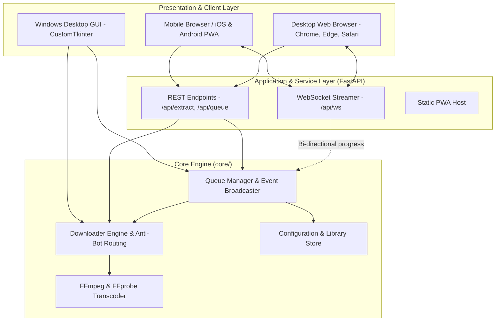

<div align="center">


# Argus Studio

**A Cross-Platform Desktop, Web & Mobile Media Ingestion and Transcoding Suite**

[](https://github.com/ChimbuezeDavid/argus-studio)
[](https://www.python.org/)
[](https://github.com/TomSchimansky/CustomTkinter)
[](https://fastapi.tiangolo.com)
[](https://github.com/yt-dlp/yt-dlp)
[](LICENSE)

[Overview](#overview) • [Engineering Challenges & Solutions](#engineering-challenges--solutions) • [Mobilization & Multi-Device Architecture](#mobilization--multi-device-architecture) • [Key Capabilities](#key-capabilities) • [System Architecture](#system-architecture) • [Installation & Usage](#installation--usage) • [Build Guide](#building-from-source)

</div>

---

## Overview

**Argus Studio** is an extensible media ingestion, transcoding, and queue management suite. Engineered with a decoupled three-tier architecture, Argus Studio runs as:
1. **A Native Desktop Application**: Responsive dark-mode Windows client powered by CustomTkinter.
2. **A Universal Web Application**: Touch-friendly browser client with bi-directional WebSocket telemetry.
3. **A Mobile Progressive Web App (PWA)**: Installable directly onto iOS and Android devices with home screen integration.
4. **A Headless Backend API Service**: FastAPI REST and WebSocket server for automation and remote execution.

---

## Engineering Challenges & Solutions

Extracting streaming media on modern systems introduces significant technical barriers, ranging from bot detection heuristics and separate DASH stream protocols to Windows I/O file locks and SSL trust store discrepancies. Argus Studio addresses each challenge through deliberate architectural mitigations:

| Technical Challenge | Root Cause / Impact | Argus Studio Engineering Solution |
| :--- | :--- | :--- |
| **YouTube Bot Verification ("Sign in to confirm you're not a bot")** | Content delivery networks reject standard HTTP requests and client signatures, blocking media inspection. | **Dynamic Client Impersonation & Fallback**: Automatically routes requests through anti-bot mobile and TV client profiles (`['android', 'ios', 'web_creator', 'mweb']`) with Node.js de-obfuscation support. |
| **FFmpeg Provisioning & SSL Certificate Failures** | Portable environments frequently lack FFmpeg, and Python `urllib` fails on clean Windows setups with `[SSL: CERTIFICATE_VERIFY_FAILED]`. | **Resilient Certifi + Unverified Fallback**: Uses `requests` with official `certifi` CA bundles and dual-mirror failover to download portable FFmpeg binaries directly to `%APPDATA%\ArgusStudio\bin\`. |
| **DASH Stream Multiplexing** | High-definition streams (1080p, 1440p, 4K) serve separate video and audio channels requiring multiplexing. | **Integrated Portable FFmpeg Engine**: Automatic multi-tier discovery (`sys._MEIPASS`, `%APPDATA%\ArgusStudio\bin`, and `PATH`) with in-app one-click installation. |
| **Windows File Locking (`WinError 32`)** | Antivirus scanners and Windows Search Indexers lock `.part` files during download finalization. | **Direct-to-Target File I/O**: Stream writes directly to destination container (`nopart: True`) with exponential retry backoff (`file_access_retries: 10`). |
| **Browser Cookie Locking** | Active web browsers hold exclusive locks on SQLite session databases. | **Non-Blocking SQLite Isolation**: Automatically releases locks and falls back to unauthenticated public endpoints without stalling the queue. |
| **Win32 OLE Cross-Thread Collisions** | Accessing the clipboard from worker threads causes Tcl/Tk native access violations on Windows. | **Thread-Safe Mainloop Polling**: Isolates all clipboard detection to Tkinter’s native event-loop scheduler (`after()`). |
| **Silent Failures in Windowed PE Builds** | Packaged GUI executables (`--noconsole`) swallow `stdout`/`stderr`, hiding errors from users. | **Diagnostic Instrumentation**: Top-level exception trapping (`sys.excepthook`) and stream redirection log full tracebacks to `%APPDATA%\ArgusStudio\argus_runtime.log` alongside native popups. |

---

## Mobilization & Multi-Device Architecture

To support seamless mobilization across Desktop, Web, and Mobile, the codebase is decoupled into clean, modular tiers:

```
argus-studio/
├── core/                   # Platform-agnostic domain engine
│   ├── engine.py           # yt-dlp wrapper, anti-bot clients, FFmpeg provisioning
│   ├── queue.py            # Multi-worker async queue with multi-subscriber listeners
│   ├── config.py           # Cross-platform config & library persistence
│   └── models.py           # Data contracts & task serialization
├── server/                 # Cross-platform REST & WebSocket service
│   └── api.py              # FastAPI endpoints (/api/extract, /api/queue, /api/ws)
├── web/                    # Universal Web & Mobile PWA client
│   ├── index.html          # Responsive single-page application
│   ├── styles.css          # Mobile-first touch-friendly stylesheet
│   ├── app.js              # Real-time WebSocket telemetry client
│   └── manifest.json       # PWA manifest for iOS/Android home-screen install
├── desktop/                # Native Windows GUI client
│   └── app.py              # CustomTkinter interface
├── app.py                  # Primary entry point (Desktop GUI or --server)
└── server.py               # Dedicated Web/Mobile backend launcher
```

---

## Key Capabilities

### Video Ingestion & Stream Multiplexing
- Supports single video, channel, and playlist extraction across multiple providers.
- Resolution selection up to 4K (2160p), 1440p, 1080p, and adaptive best-quality profiles.
- Automatic multiplexing into standardized MP4 and MKV containers.

### Audio Extraction & Metadata Tagging
- Audio transcoding to MP3 (up to 320 kbps), M4A (AAC), FLAC (lossless), and WAV.
- Automatic thumbnail retrieval, aspect ratio normalization, and cover art embedding (ID3v2 APIC).
- Standardized ID3v2.3/v2.4 and Vorbis comment tagging powered by Mutagen.

### Selective Ingestion & Clipping
- Client-side stream slicing using precise start/end timestamps without fetching unnecessary data blocks.
- Track extraction and sequential index prefixing for channel and playlist imports.

### Closed Captions & Subtitles
- Parsing of embedded and automated subtitle tracks across international languages.
- Direct stream container embedding or sidecar `.srt` file extraction.

### Queue Management & Concurrency
- Configurable worker pool (1 to 5 concurrent jobs) with non-blocking execution.
- Real-time telemetry reporting: transfer velocity, percentage completion, size indicators, and ETA.
- Bi-directional WebSocket progress broadcasting to all connected mobile, web, and desktop clients.

---

## System Architecture



---

## Installation & Usage

### 🖥️ Native Desktop Application (Windows)
Download and execute `ArgusStudio-Setup.exe` or `ArgusStudio-Portable.exe` from the latest release:
- Installs to `%LOCALAPPDATA%\Programs\ArgusStudio`.
- Standard user privileges (no Administrator rights required).

### 📱 Mobilization: Web & Mobile PWA Setup
Run the embedded universal server:
```powershell
python server.py
# Or launch app.py in server mode:
python app.py --server
```
1. **Local Access**: Open `http://localhost:8000` in any browser.
2. **Mobile Access**: Open `http://<your-computer-ip>:8000` on your iPhone or Android phone connected to the same Wi-Fi.
3. **Install as Native Mobile App**:
   - **iOS (Safari)**: Tap the Share button ➔ **Add to Home Screen**.
   - **Android (Chrome)**: Tap the menu ➔ **Install app** or **Add to Home Screen**.

---

## Building from Source

### Prerequisites
- **Python 3.10** or higher
- **Inno Setup 6** (optional, required only for compiling the installer wizard)

### Environment Setup
```powershell
# 1. Clone the repository
git clone https://github.com/ChimbuezeDavid/argus-studio.git
cd argus-studio

# 2. Install dependencies
pip install -r requirements.txt

# 3. Launch Desktop GUI
python app.py

# 4. Launch Web / Mobile Server
python server.py
```

### Compiling Binaries
Execute the build pipeline script:
```powershell
.\build_exe.bat
```
This automated process:
1. Executes `PyInstaller` using [`ArgusStudio.spec`](ArgusStudio.spec), packaging the desktop app and the web/mobile PWA interface.
2. Compiles standalone binary to `dist\ArgusStudio.exe` and `dist\ArgusStudio-Portable.exe`.
3. Invokes the Inno Setup compiler to generate `dist\ArgusStudio-Setup.exe`.

---

## Diagnostics & Troubleshooting

- **Runtime Logs**: Detailed execution traces are written to:
  ```
  %APPDATA%\ArgusStudio\argus_runtime.log
  ```
- **FFmpeg Status**: Check binary status under **Settings > Media Transcoding Engine**. If missing, use the **Install Portable FFmpeg** button to provision a static portable build automatically with zero SSL errors.

---

## License

This project is licensed under the MIT License. See the [LICENSE](LICENSE) file for full details.
