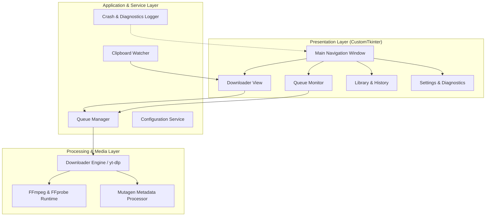

<div align="center">


# Argus Studio

**A High-Performance Desktop Media Ingestion and Transcoding Suite for Windows**

[](https://microsoft.com)
[](https://www.python.org/)
[](https://github.com/TomSchimansky/CustomTkinter)
[](https://github.com/yt-dlp/yt-dlp)
[](LICENSE)

[Overview](#overview) • [Engineering Challenges & Solutions](#engineering-challenges--solutions) • [Key Capabilities](#key-capabilities) • [Architecture](#system-architecture) • [Installation](#installation--distribution) • [Build Guide](#building-from-source)

</div>

---

## Overview

**Argus Studio** is a standalone Windows desktop application designed for high-fidelity media extraction, transcoding, and queue management. Built on modern Python, `yt-dlp`, and CustomTkinter, it provides a resilient pipeline capable of resolving modern streaming restrictions, stream multiplexing requirements, and Windows-specific concurrency constraints.

---

## Engineering Challenges & Solutions

Extracting streaming media on modern Windows desktop environments introduces significant technical constraints, ranging from bot detection heuristics and separate DASH stream protocols to Windows I/O file locks. Argus Studio addresses each challenge through deliberate architectural mitigations:

| Technical Challenge | Root Cause / Impact | Argus Studio Engineering Solution |
| :--- | :--- | :--- |
| **DASH Stream Separation** | High-definition formats (1080p, 1440p, 4K) serve video and audio as separate streams requiring multiplexing. Standard systems fail without external tools. | **Integrated FFmpeg Pipeline**: Implements automatic multi-path discovery (`sys._MEIPASS`, `%APPDATA%\ArgusStudio\bin`, and `PATH`) with a built-in one-click provisioner for portable static FFmpeg binaries. |
| **Bot Detection & JavaScript Challenges** | Content delivery networks enforce client-side signature decryption and dynamic challenge tokens to prevent programmatic access. | **Dynamic Runtime Decryption**: Integrates Node.js execution with dynamic challenge components (`remote_components: {'ejs:github'}`), complemented by automated fallback routines for offline environments. |
| **Windows File Locking (`WinError 32`)** | Windows Search Indexer and antivirus software lock temporary `.part` files during rename operations upon download completion. | **Direct-to-Target File I/O**: Disables multi-stage file staging (`nopart: True`) and applies automated access retry strategies (`file_access_retries: 10`) to eliminate locking collisions. |
| **Browser Database Contention** | Active web browsers hold exclusive locks on their SQLite cookie databases, preventing credential inspection. | **Non-Blocking Cookie Isolation**: Detects browser locking states, safely releases SQLite file locks, and falls back to unauthenticated public endpoints without stalling the queue. |
| **Cross-Thread UI Collisions** | Accessing the Win32 OLE clipboard from background worker threads causes race conditions and Tcl/Tk native access violations. | **Thread-Safe Event Loop Polling**: Relies on Tkinter’s native event loop scheduling (`after()`) rather than background OS-level hooks, isolating all clipboard inspection to the UI thread. |
| **Silent Failures in Windowed PE Builds** | Packaged GUI executables (`--noconsole`) swallow `stdout`/`stderr`, leaving users without feedback during unexpected crashes. | **Persistent Diagnostic Instrumentation**: Top-level exception trapping (`sys.excepthook`) and safe stream redirection log complete tracebacks to `%APPDATA%\ArgusStudio\argus_runtime.log` alongside native error dialogs. |

---

## Key Capabilities

### Video Ingestion & Stream Multiplexing
- Supports single video, channel, and playlist extraction across multiple providers.
- Resolution selection up to 4K (2160p), 1440p, 1080p, and adaptive best-quality profiles.
- Automatic multiplexing into standardized MP4 and MKV containers.

### Audio Extraction & Metadata Tagging
- Audio transcoding to MP3 (up to 320 kbps), M4A (AAC), FLAC (lossless), and WAV.
- Automatic thumbnail retrieval, aspect ratio normalization, and cover art embedding (ID3v2 APIC).
- Standardized ID3v2.3/v2.4 and Vorbis comment tagging powered by Mutagen.

### Selective Ingestion & Clipping
- Client-side stream slicing using precise start/end timestamps without fetching unnecessary data blocks.
- Track extraction and sequential index prefixing for channel and playlist imports.

### Closed Captions & Subtitles
- Parsing of embedded and automated subtitle tracks across international languages.
- Direct stream container embedding or sidecar `.srt` file extraction.

### Queue Management & Concurrency
- Configurable worker pool (1 to 5 concurrent jobs) with non-blocking execution.
- Real-time telemetry reporting: transfer velocity, percentage completion, size indicators, and ETA.
- Configurable global bandwidth rate limiter.

---

## System Architecture

Argus Studio is organized into discrete, loosely-coupled subsystems:



| Layer | Component | Core Responsibility |
| :--- | :--- | :--- |
| **Presentation** | `app.py` | UI rendering, user interaction, progress dispatching, and thread-safe event scheduling. |
| **Queue & Concurrency** | `download_queue.py` | Asynchronous task scheduling, worker pool management, and state notification. |
| **Media Processing** | `downloader_engine.py` | Media stream resolution, FFmpeg multiplexing, audio conversion, and error translation. |
| **Diagnostics** | `argus_runtime.log` | Persistent runtime logging and structured traceback capture. |

---

## Installation & Distribution

### Option 1: Windows Setup Wizard (Recommended)
Download and execute `ArgusStudio-Setup.exe` from the latest release:
- Installs to `%LOCALAPPDATA%\Programs\ArgusStudio`.
- Automatically provisions desktop and Start Menu shortcuts.
- Includes a clean system uninstaller.
- Runs with standard user privileges (no Administrator rights required).

### Option 2: Portable Standalone Executable
- Download `ArgusStudio.exe`.
- Self-contained portable binary: runs directly from any local directory or removable drive without prior setup.

---

## Building from Source

### Prerequisites
- **Python 3.10** or higher
- **Inno Setup 6** (optional, required only for compiling the installer wizard)
- **Node.js** (optional, used for extended client challenge resolution)

### Environment Setup
```powershell
# 1. Clone the repository
git clone https://github.com/ChimbuezeDavid/argus-studio.git
cd argus-studio

# 2. Install dependencies
pip install -r requirements.txt

# 3. Launch application directly
python app.py
```

### Compiling Binaries
Execute the build pipeline script:
```powershell
.\build_exe.bat
```
This automated process:
1. Executes `PyInstaller` using the production specification file ([`ArgusStudio.spec`](ArgusStudio.spec)).
2. Compiles standalone binary to `dist\ArgusStudio.exe`.
3. Invokes the Inno Setup compiler (`ISCC.exe`) to generate `dist\ArgusStudio-Setup.exe`.

---

## Diagnostics & Troubleshooting

Argus Studio includes built-in diagnostics to assist in isolating issues across diverse hardware configurations:

- **Runtime Logs**: Detailed execution traces are written to:
  ```
  %APPDATA%\ArgusStudio\argus_runtime.log
  ```
  This file can be opened directly from the **Settings > Diagnostics** panel.
- **FFmpeg Status**: Verify active binary resolution status under **Settings > Media Transcoding Engine**. If missing, use the **Install Portable FFmpeg** button to provision a static portable build automatically.

---

## License

This project is licensed under the MIT License. See the [LICENSE](LICENSE) file for full details.
